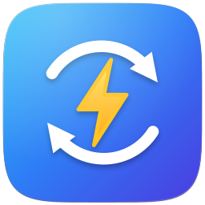
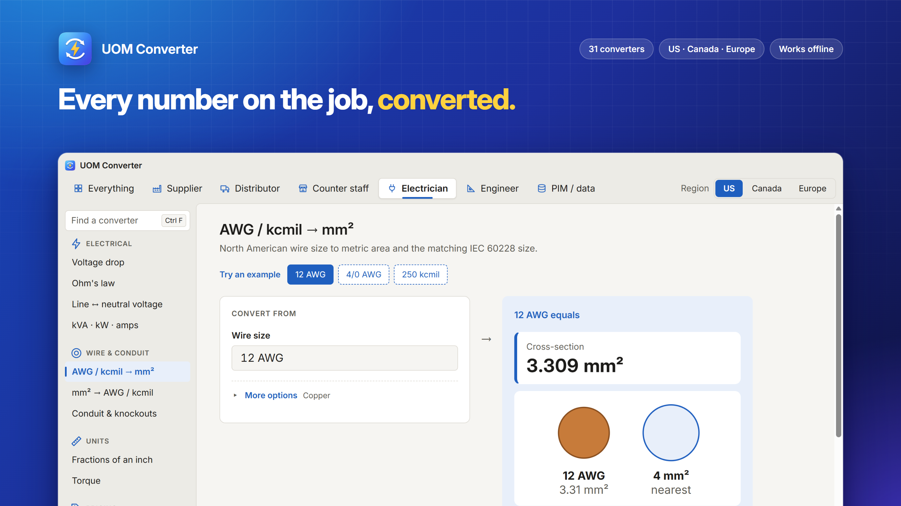
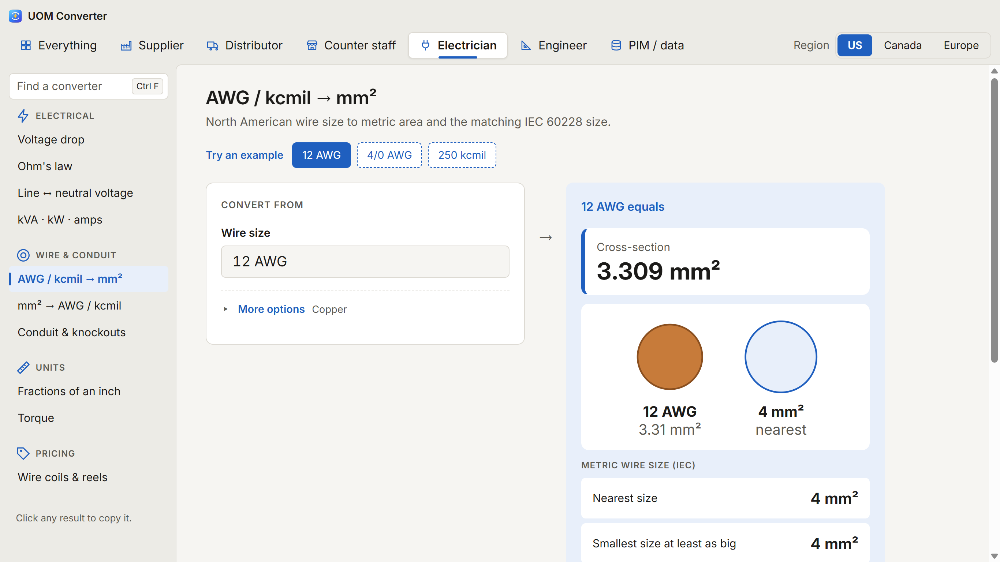
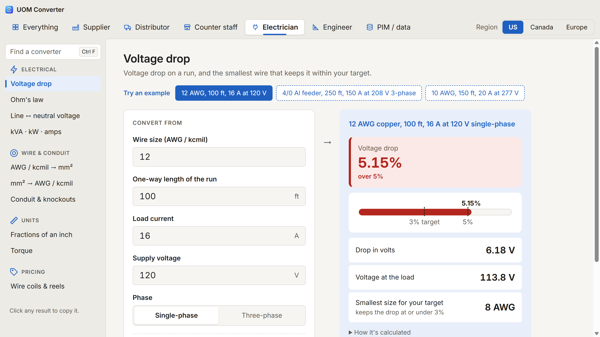
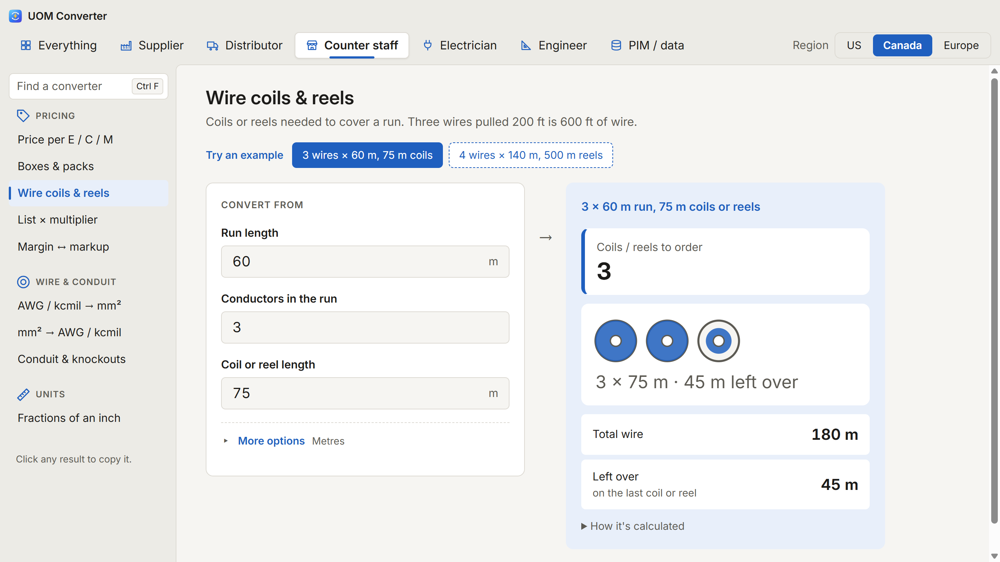

<div align="center">

  <br>

  <a href="https://apps.microsoft.com/detail/9PHZQBV736JC"></a>
  <a href="https://github.com/chengmarc/uom-converter/releases/latest/download/UOM-Converter-setup.exe"></a>

  <h1>UOM Converter - Unit Converter for Electrical Industry</h1>

  **[Use it in your browser](https://uom-converter.com/)**

  

</div>

## Screenshots





## Quick start

```
npm install
npm test           # unit tests
npm run typecheck
```

Links open a specific view: `?for=engineer&region=eu#vdrop`.

## Layout

The converters are shared; each platform decides how they look and ships them its own way.

```
src/
  core/          the math: wire sizes, conduit, electrical, pricing, units, codes
  converters/    each converter's fields, examples and compute, plus number formats and regions;
                 diagrams and tables as data, so nothing here depends on a page
  brand/         the app icon every platform's icons are made from
  ui/            a converter drawn as HTML (form, result, diagrams), the roles and the icons,
                 for the platforms built on a web page; each styles it its own way
platforms/
  web/           the website: header, home page, a page per converter, footer, and its build
  windows/       the app window (app/), Electron shell, electron-builder config, Store assets
  android/       the app screens (app/), the Capacitor native project (android/), icons
```

## Website

Every converter at its own address (`/voltage-drop-calculator`, `/awg-to-mm2`…) so searches
can land on it. Each page's title and description are in `platforms/web/pages.ts`;
`platforms/web/vite.config.ts` writes the pages, a sitemap, and an offline copy for phones.

```
npm run dev           # live-reloading at http://localhost:5173/
npm run build:web     # platforms/web/dist/
npm run preview:web   # serve platforms/web/dist/ at http://localhost:4173/
npm run deploy:web    # build and deploy to Cloudflare (needs `npx wrangler login` once)
```

It is served at <https://uom-converter.com/> by Cloudflare Workers as static files
(`platforms/web/wrangler.jsonc`, no Worker code). Cloudflare's Git integration deploys every push
to `main`; `.github/workflows/checks.yml` runs the tests and the build on GitHub. Set `SITE_URL`
to build it for another address.

## Windows app (.exe)

The page wrapped in Electron (`platforms/windows/electron/main.cjs`). It is served from a private
`app://` scheme, with no Node access in the page, a sandboxed renderer and a content security
policy. electron-builder's settings are in `platforms/windows/electron-builder.json`, and builds
land in `platforms/windows/release/`.

```
npm run app        # build the page and open it in the desktop shell
npm run dist:win   # UOM-Converter-setup.exe and UOM-Converter-portable.exe
```

## Microsoft Store (.appx)

The Store build is an MSIX package. Partner Center signs it on submission, so it needs no
certificate of its own.

```
npm run store:assets   # re-render the app icon and platforms/windows/store/ from the icon and the built page
npm run dist:store     # UOM-Converter-<version>.appx
```

## Android app

Its own phone screens (`platforms/android/app/`) in a Capacitor app, package `com.uomconverter.app`.
Needs Android Studio, for the SDK and emulator; `platforms/android/gradle.cjs` finds its Java and
SDK and passes `HTTPS_PROXY` on to Gradle.

```
npm run android:run     # build, install and open on the running emulator or device
npm run android:apk     # debug .apk in platforms/android/android/app/build/outputs/apk/debug/
npm run android:icons   # re-render the launcher icons and the Play icon from the app icon
```

`capacitor.config.json` sits at the repo root because the Capacitor CLI runs from there. The
version comes from `package.json` (1.2.3 is Play's versionCode 10203).

## Releasing

Windows releases follow the [release guide](platforms/windows/RELEASING.md): the `.exe` files go
on GitHub Releases, the `.appx` to the Microsoft Store. Changes are listed in the
[changelog](docs/CHANGELOG.md), and the app's [privacy policy](PRIVACY.md) covers every edition.
