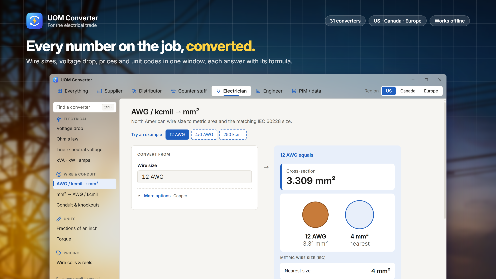

<div align="center">

  <br>

  <a href="https://github.com/chengmarc/uom-converter/releases/latest/download/UOM-Converter-setup.exe"></a>
  <a href="https://apps.microsoft.com/detail/9PHZQBV736JC"></a>
  <a href="https://play.google.com/store/apps/details?id=com.uomconverter.app"></a>
  <h1>UOM Converter - Unit Converter for Electrical Industry</h1>

  

</div>

## Screenshots


## Quick start

```
npm install
npm test           # unit tests
npm run typecheck
```

Links open a specific view: `?for=engineer&region=eu#vdrop`.

## Layout

An npm workspace: the converters are shared packages, and each app decides how they look and
ships them its own way. Every command below runs from the repo root.

```
packages/
  core/          @uom/core: the math: wire sizes, conduit, electrical, pricing, units, codes
  converters/    @uom/converters: each converter's fields, examples and compute, plus number
                 formats and regions; diagrams and tables as data, so nothing here depends on a page
  ui/            @uom/ui: a converter drawn as HTML (form, result, diagrams), the roles and the
                 icons, for the apps built on a web page; each styles it its own way
  brand/         @uom/brand: the app icon every app's icons are made from
apps/
  web/           the website: header, home page, a page per converter, footer, and its build
  windows/       the Electron app: its page (src/renderer/) and shell (src/main/), Store assets
  android/       the app screens (src/), the Capacitor native project (native/), icons
```

Inside an app, `src/` is its source, `scripts/` its helpers (icon renderers, the Gradle runner),
`store/` its listing, and its tools' configs sit at its root. Builds land in `dist/`.

Live preview, reloading on every save:

```
npm run dev           # the website, at http://localhost:5173/
npm run dev:windows   # the Windows app, in its own window
npm run dev:android   # the Android app, on an emulator (started if need be) or USB phone
```

Each package and app has its own `package.json` listing what it uses; the apps import the
packages by name (`@uom/converters`). Packages are TypeScript source, not built on their own:
each app's Vite build compiles what it imports. One version covers every app: the root
`package.json`'s.

## Website

Every converter at its own address (`/voltage-drop-calculator`, `/awg-to-mm2`…) so searches
can land on it, and a page per topic listing its converters (`/electrical`, `/units`…). Each
page's title and description are in `apps/web/src/pages.ts`; `apps/web/vite.config.ts` writes
the pages with their content drawn in, a sitemap, `llms.txt`, and an offline copy for phones.
`npm run check:web` checks the built pages as search engines read them.

```
npm run dev           # live-reloading at http://localhost:5173/
npm run build:web     # apps/web/dist/
npm run preview:web   # serve apps/web/dist/ at http://localhost:4173/
npm run deploy:web    # build and deploy to Cloudflare (needs `npx wrangler login` once)
```

It is served at <https://uom-converter.com/> by Cloudflare Workers as static files
(`apps/web/wrangler.jsonc`, no Worker code). Cloudflare's Git integration deploys every push
to `main`; `.github/workflows/checks.yml` runs the tests and the build on GitHub. Set `SITE_URL`
to build it for another address.

## Windows app (.exe)

The page wrapped in Electron (`apps/windows/src/main/main.cjs`). It is served from a private
`app://` scheme, with no Node access in the page, a sandboxed renderer and a content security
policy. electron-builder's settings are in `apps/windows/packaging/electron-builder.config.cjs`, and builds
land in `apps/windows/release/`.

```
npm run app        # build the page and open it in the desktop shell
npm run dist:win   # UOM-Converter-setup.exe
```

## Microsoft Store (.appx)

The Store build is an MSIX package. Partner Center signs it on submission, so it needs no
certificate of its own.

```
npm run store:assets   # re-render the app icon and apps/windows/store/ from the icon and the built page
npm run dist:store     # UOM-Converter-<version>.appx
```

## Android app

Its own phone screens (`apps/android/src/`) in a Capacitor app, package `com.uomconverter.app`.
Needs Android Studio, for the SDK and emulator; `apps/android/scripts/gradle.cjs` finds its Java and
SDK and passes `HTTPS_PROXY` on to Gradle.

```
npm run android:run     # build, install and open on the running emulator or device
npm run android:apk     # debug .apk in apps/android/native/app/build/outputs/apk/debug/
npm run android:icons   # re-render the launcher icons and the Play icon from the app icon
```

Its Capacitor settings are in `apps/android/capacitor.config.ts`. The version comes from the
root `package.json` (1.2.3 is Play's versionCode 10203).

## Releasing

Windows releases follow the [release guide](docs/RELEASING.md): the `.exe` files go
on GitHub Releases, the `.appx` to the Microsoft Store. Changes are listed in the
[changelog](docs/CHANGELOG.md), and the app's [privacy policy](PRIVACY.md) covers every edition.

## License

[Apache 2.0](LICENSE).

Google Play and the Google Play logo are trademarks of Google LLC.
